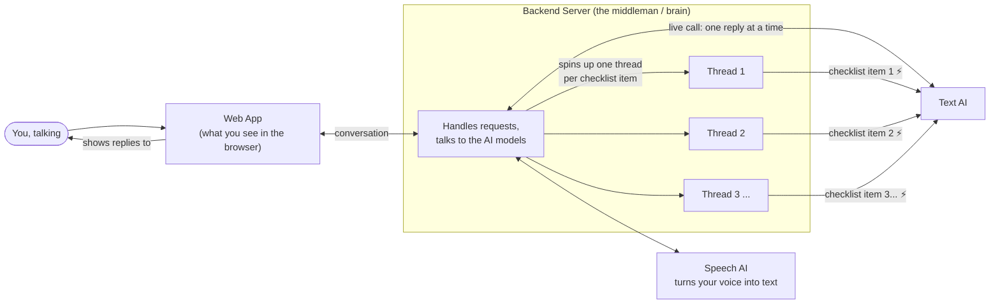

# Architecture

This app does two things:

1. **Live call** — you play the role of a Doctor and talk out loud. A simulated Patient
   (AI) answers back in real time, like a phone call.
2. **Checklist evaluation** — after a call (or with any pasted transcript), the app checks
   the conversation against a checklist and marks each item yes / no / unclear.

## The big picture

Four pieces, four jobs:

| Piece                      | What it does                                                                                                     |
| -------------------------- | ---------------------------------------------------------------------------------------------------------------- |
| **Browser (Web App)**      | What you see and click — chat bubbles, the checklist editor, Start/End Call.                                     |
| **Backend Server**         | The middleman. Talks to the AI models and keeps the conversation moving.                                         |
| **Speech AI** (Nova Sonic) | Listens to your voice and turns it into text. That's its only job here.                                          |
| **Text AI** (Nova Micro)   | Two separate jobs: plays the Patient during the call, and scores the transcript against the checklist afterward. |

## How a live call works

1. You click **Start Call** and start talking.
2. Your voice goes to the Speech AI, which turns it into text.
3. As soon as a sentence is transcribed, the Backend asks the Text AI: _"You're playing this patient — how do they respond?"_
4. The reply appears as a new chat bubble, in character.
5. Repeat until you click **End Call** — the whole conversation becomes a transcript.

> As a bonus, the browser also has its own quick (but less accurate) built-in speech-to-text, so words appear on screen instantly while you talk. Once the more accurate Speech AI catches up a moment later, it quietly corrects that same line instead of adding a second one.

## How evaluation works

1. You save a checklist (a list of things that should happen in the conversation).
2. You click **Run Evaluation** on a transcript (from a live call, or pasted in directly).
3. For **every** checklist item, the Backend asks the Text AI: _"Did this happen in the conversation?"_ — **all at once, in parallel**, not one at a time.
4. Each answer (yes / no / unclear) streams back next to its checklist item as soon as it's ready, with a short quote as evidence.

Asking one at a time would mean waiting for each answer before asking the next — slow. Instead, the Backend spins up one thread per checklist item (see the diagram above) so every question runs at the same time. This is why a 6-item checklist takes about **1 second** instead of the ~5 seconds it would take asking one question after another.

## Tech stack

**Frontend**

| Technology                                     | What it's for                                                   |
| ---------------------------------------------- | --------------------------------------------------------------- |
| Next.js + React + TypeScript                   | The web app itself                                              |
| Mantine                                        | Pre-built UI components (buttons, cards, inputs)                |
| Web Audio API + WebSocket _(browser built-in)_ | Captures your mic and streams it live to the backend            |
| Web Speech API _(browser built-in)_            | The quick, on-screen-instantly (but less accurate) live preview |

**Backend**

| Technology                                         | What it's for                                                                                                                      |
| -------------------------------------------------- | ---------------------------------------------------------------------------------------------------------------------------------- |
| Python 3.12                                        | The language the backend is written in                                                                                             |
| FastAPI + Uvicorn                                  | The web server that handles requests and the live-call WebSocket                                                                   |
| boto3                                              | Talks to the Text AI (Nova Micro)                                                                                                  |
| aws-sdk-bedrock-runtime + smithy-aws-core + awscrt | Talks to the Speech AI (Nova Sonic) — it needs a live, two-way audio connection, which needs a different, newer toolkit than boto3 |
| PyYAML                                             | Reads and writes checklists, which are stored as plain YAML files                                                                  |

**AI / Cloud**

| Technology     | What it's for                                |
| -------------- | -------------------------------------------- |
| Amazon Bedrock | The cloud platform that hosts both AI models |
| Nova 2 Sonic   | The Speech AI                                |
| Nova Micro     | The Text AI                                  |

## Where things live

| Folder      | What's in it                                                   |
| ----------- | -------------------------------------------------------------- |
| `backend/`  | The Backend Server — a Python app that talks to the AI models. |
| `frontend/` | The Web App — what runs in your browser.                       |

**Backend — the important files:**

| File                             | What it's for                                                  |
| -------------------------------- | -------------------------------------------------------------- |
| `server.py`                      | The main backend app; wires everything else together.          |
| `checklist_qa/nova_sonic_stt.py` | Turns your voice into text.                                    |
| `checklist_qa/live_call.py`      | Picks a random patient scenario and keeps the AI in character. |
| `checklist_qa/evaluator.py`      | Scores a transcript against a checklist.                       |

**Frontend — the important files:**

| File                             | What it's for                                            |
| -------------------------------- | -------------------------------------------------------- |
| `components/LiveCall.tsx`        | The whole live-call screen — mic, chat bubbles, buttons. |
| `components/ChecklistEditor.tsx` | The checklist editor and results view.                   |
| `app/page.tsx`                   | The main page that puts everything together.             |
